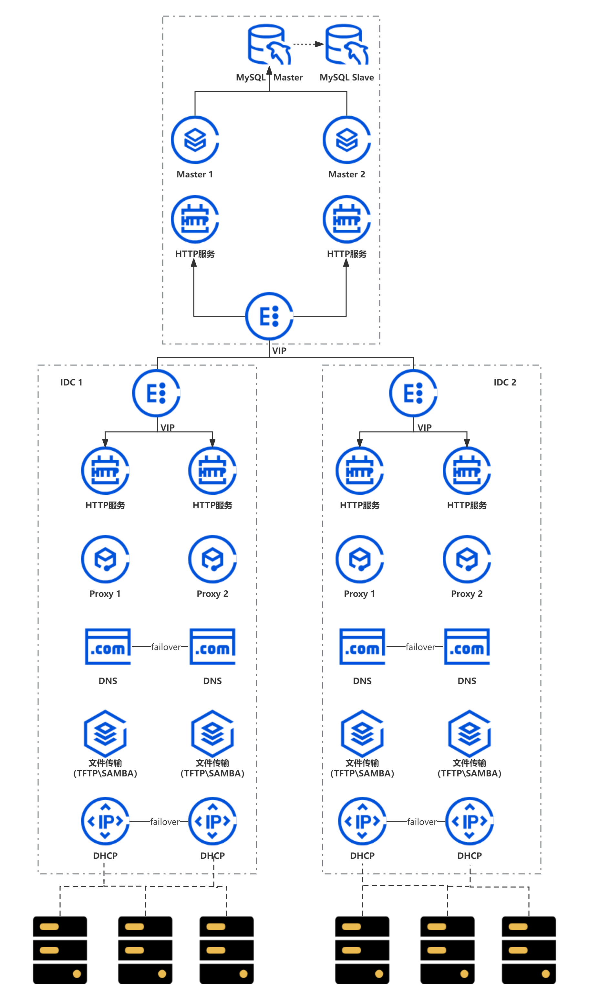

English | [简体中文](./README.md)

# CyclOne

#### Description

CyclOne is a one-stop resource full-cycle management platform.

Built through secondary development on top of open-source components, CyclOne
revolves around the core functional modules of **data centers, racks, networks,
bare-metal resource pools, hardware inspection, automated deployment, and
out-of-band management**. Combining the closed-loop full-lifecycle management
philosophy with purpose-designed operational workflows, it delivers a
*"dual-capable"* platform:

- **Deployment architecture — flexible and reliable**
- **Resource architecture — compatible and extensible**

#### Software Architecture



#### Installation

**0. Prerequisites**

- Operating system: `openEuler 20.03 (LTS-SP3)`
- Container runtime: `systemd-nspawn`

**1. Download the installation package**

- <https://atomgit.com/src-openeuler/CyclOne>

**2. Deploy the container**

- Extract `cyclone.tar`

```bash
umask 022
mkdir -p /data/cyclone
tar --numeric-owner -xpf cyclone.tar -C /data/cyclone
```

- Create the systemd-nspawn service

```ini
cat > /lib/systemd/system/systemd-nspawn@.service <<'EOF'
[Unit]
Description=Container %I
Documentation=man:systemd-nspawn(1)
PartOf=machines.target
Before=machines.target

[Service]
ExecStart=/usr/bin/systemd-nspawn --quiet --keep-unit --boot --link-journal=try-guest --machine=%I -D /data/%I
KillMode=mixed
Type=notify
RestartForceExitStatus=133
SuccessExitStatus=133
Slice=machine.slice
Delegate=yes

[Install]
WantedBy=machines.target
EOF
```

- Start the CyclOne container

```bash
systemctl stop firewalld
setenforce 0
systemctl enable systemd-nspawn@cyclone
systemctl start systemd-nspawn@cyclone
```

#### Instructions

1. Access the platform at <http://127.0.0.1>

#### Contribution

1. Fork this repository
2. Create a `Feat_xxx` branch
3. Commit your code
4. Create a Pull Request
